# Intelligent Hybrid Network Intrusion Detection, Analysis and Automated Prevention System (NIDS/NIPS)

[](https://www.python.org/)
[](https://fastapi.tiangolo.com/)
[](https://streamlit.io/)
[](https://xgboost.readthedocs.io/)
[](LICENSE)

An enterprise-grade, defense-in-depth cybersecurity platform that combines **signature-based intrusion detection**, **supervised machine learning classification**, **unsupervised anomaly detection**, **explainable AI (SHAP)**, **multi-factor threat severity scoring**, and **automated Linux nftables mitigation** backed by a **FastAPI** service and a real-time **Streamlit** SOC operations dashboard.

---

## 1. Project Overview

Traditional intrusion detection systems rely almost exclusively on static signature patterns, leaving networks blind to zero-day exploits, evasive polymorphic malware, and slow brute-force attacks. Conversely, purely academic machine learning models frequently suffer from severe data leakage, brittle feature dependencies, high false positive rates, and lack of operational explainability.

This project delivers a **modular, production-ready Hybrid Network Intrusion Detection and Prevention System (NIDS/NIPS)** designed to bridge this divide. It correlates deterministic signatures (Suricata), supervised learning (XGBoost, Random Forest, Logistic Regression, LightGBM), and unsupervised anomaly detection (Isolation Forest) into an interpretable risk matrix, presenting security analysts with transparent SHAP explanations and controlled firewall mitigation mechanisms.

---

## 2. Problem Statement

Modern enterprise networks face sophisticated threat actors leveraging targeted attacks that bypass legacy perimeter defenses. Security teams contend with:
1. **Signature Blindspots**: Inability of signature matching to catch zero-day attacks or protocol anomalies.
2. **Alert Fatigue**: Floods of unweighted alerts lacking severity context or model confidence scores.
3. **Black-Box AI**: Unwillingness of analysts to trust ML predictions without interpretable feature attribution.
4. **Data Leakage in Research**: Models trained with non-generalizable identifiers (`src_ip`, `dst_ip`, timestamps) failing in production.
5. **Rigid Mitigation**: High risk of unintended service outages caused by unrestricted automated blocking without safety constraints or simulation modes.

---

## 3. Key Objectives

- **Unified Defense-in-Depth Architecture**: Seamlessly combine Suricata signatures, supervised classification, and Isolation Forest anomaly baselines.
- **Leakage-Free Feature Engineering**: Enforce rigorous data sanitization across 65 standardized network flow metrics while strictly excluding IP addresses and timestamps from predictive feature sets.
- **Explainable Threat Attribution**: Integrate SHAP (SHapley Additive exPlanations) to demystify every flagged anomaly and suspicious flow.
- **Configurable Multi-Factor Risk Scoring**: Implement an interpretable 0–100 risk score based on model confidence, attack category severity, anomaly score, and connection frequency.
- **Safe Automated Containment**: Integrate Linux `nftables` with strict protected-IP safeguards, duplicate rule suppression, automatic rule expiration, and simulation modes.
- **Dual Operational Modes**: Full functionality in both **Offline Analysis** (PCAP files, CIC-IDS2017, UNSW-NB15) and **Live Monitoring** (Zeek, Suricata, network interfaces).

---

## 4. Architecture & System Design

```mermaid
flowchart TD
    subgraph Ingestion["1. Traffic Ingestion Tier"]
        PCAP["PCAP / PCAPNG Files"]
        LiveNet["Network Interface (Scapy)"]
        Suricata["Suricata EVE JSON Logs"]
        Zeek["Zeek Metadata Logs (conn/dns/http)"]
        Datasets["Datasets (CIC-IDS2017, UNSW-NB15)"]
    end

    subgraph Preprocessing["2. Feature Engineering & Preprocessing"]
        Extractor["Flow Extractor (65 Features)"]
        Sanitizer["Sanitizer (NaN/Inf Cleaning)"]
        LeakageGuard["Leakage Guard (Drops IP, Timestamp, FlowID)"]
        Scaler["StandardScaler & Protocol Encoder"]
    end

    subgraph DetectionTier["3. Multi-Engine Detection Tier"]
        SigEngine["Signature Engine (Suricata)"]
        SupervisedML["Supervised Classifier (XGBoost / RF / LightGBM)"]
        AnomalyEngine["Anomaly Engine (Isolation Forest)"]
    end

    subgraph CorrelationTier["4. Correlation & Explainability Tier"]
        Correlator["Hybrid Aggregator"]
        SHAP["Explainable AI (SHAP TreeExplainer)"]
        RiskEngine["Risk Engine (0-100 Multi-Factor Score)"]
    end

    subgraph MitigationTier["5. Mitigation & Persistence Tier"]
        DB[(SQLite Database)]
        Audit["Audit Logger"]
        Nftables["nftables Firewall Manager"]
    end

    subgraph UserTier["6. User Interfaces"]
        API["FastAPI REST API (:8000)"]
        Dashboard["Streamlit SOC Dashboard (:8501)"]
    end

    Ingestion --> Preprocessing
    Preprocessing --> DetectionTier
    DetectionTier --> CorrelationTier
    CorrelationTier --> MitigationTier
    MitigationTier --> UserTier
```



For detailed sequence diagrams, database entity models, and deep subsystem design, refer to [docs/ARCHITECTURE.md](docs/ARCHITECTURE.md).

---

## 5. Technology Stack

- **Core Runtime**: Python 3.11+
- **Data & Numerical Processing**: NumPy, Pandas, Scikit-learn, Joblib
- **Machine Learning & Explainability**: XGBoost, LightGBM, Random Forest, Logistic Regression, Isolation Forest, Imbalanced-learn (SMOTE), SHAP
- **Network Traffic Monitoring**: Scapy, Wireshark-compatible PCAP/PCAPNG, Suricata (EVE JSON), Zeek logs
- **Backend & REST API**: FastAPI, Pydantic v2, SQLAlchemy 2.0, Uvicorn, HTTPX
- **Operations Dashboard**: Streamlit, Plotly Express & Graph Objects
- **Database**: SQLite (SQLAlchemy ORM with indexing)
- **Firewall & Mitigation**: Linux `nftables` (via secure parameter-list `subprocess`), Audit Trail
- **Testing & Quality Assurance**: Pytest, Pytest-AsyncIO

---

## 6. Installation & Quick Start

### 6.1 Local Setup

1. **Clone repository and setup virtual environment**:
   ```bash
   cd network-ids
   python -m venv venv
   # On Linux/macOS:
   source venv/bin/activate
   # On Windows:
   .\venv\Scripts\Activate.ps1
   ```

2. **Install dependencies**:
   ```bash
   pip install -r requirements.txt
   ```

3. **Configure environment variables**:
   ```bash
   cp .env.example .env
   ```

4. **Seed sample data & database**:
   ```bash
   python scripts/generate_sample_data.py
   ```

5. **Start FastAPI Backend Service**:
   ```bash
   uvicorn backend.main:app --host 127.0.0.1 --port 8000 --reload
   ```

6. **Start Streamlit SOC Dashboard** (in another terminal):
   ```bash
   streamlit run frontend/app.py --server.port 8501
   ```
   Open `http://localhost:8501` to access the Security Operations Center.

### 6.2 Docker Deployment
```bash
docker-compose up --build
```
Access the Dashboard at `http://localhost:8501` and the Swagger API docs at `http://localhost:8000/docs`.

---

## 7. Dataset Preparation & Ingestion

The platform features built-in dataset import and schema mapping for the two primary intrusion detection research benchmarks:
- **CIC-IDS2017**: [UNB CIC-IDS2017 Official Source](https://www.unb.ca/cic/datasets/ids-2017.html)
- **UNSW-NB15**: [UNSW-NB15 Research Dataset](https://research.unsw.edu.au/projects/unsw-nb15-dataset)

### Ingestion Interface
In the **Model Laboratory** dashboard page:
1. Upload any raw CSV dataset file.
2. View the automated **Validation Summary**: row/column counts, missing values report, duplicate row count, and class distribution histograms.
3. Features are automatically aligned to `FEATURE_SCHEMA` (65 metrics).

---

## 8. Model Training & Evaluation Workflow

1. Navigate to **Model Laboratory -> Train & Compare**.
2. Select your architecture:
   - **XGBoost** (Primary candidate)
   - **Random Forest**
   - **Logistic Regression**
   - **LightGBM**
3. Select task: **Binary** (`BENIGN` vs `Malicious`) or **Multiclass** (`DoS`, `PortScan`, `Brute Force`, `Botnet`, etc.).
4. Click **Start Training**:
   - The engine automatically isolates identifier columns (`src_ip`, `dst_ip`, `timestamp`, `flow_id`).
   - Stratified train-test splits are performed.
   - SMOTE oversampling is applied strictly to training folds.
   - Model artifacts and scalers are persisted to `models/`.
5. Evaluate models to generate confusion matrix heatmaps, macro precision/recall/F1, false positive rates, and inference latency measurements.

---

## 9. Operating Modes

### Mode A: Offline Analysis
- Import PCAP captures via **Live Monitoring** or REST endpoint `POST /api/pcap/analyse`.
- Extract bidirectional 5-tuple network flows.
- Classify flows with active ML models and Isolation Forest.
- Generate investigation reports with SHAP feature explanations.

### Mode B: Live Monitoring
- Capture live packets using Scapy or `tcpdump`.
- Continuously ingest Suricata `eve.json` alerts and Zeek connection logs.
- Stream telemetry directly to the dashboard with automated containment triggers.

---

## 10. Threat Severity Scoring & Mitigation

### Risk Score Calculation
Every incident is scored on a normalized 0–100 scale:
$$\text{Risk Score} = 0.40 \cdot \text{Confidence} + 0.30 \cdot \text{Severity} + 0.20 \cdot \text{Anomaly} + 0.10 \cdot \text{Frequency}$$

| Risk Score | Severity Level | Policy / Action |
| :--- | :--- | :--- |
| **0 – 29** | Low | Telemetry logging |
| **30 – 59** | Medium | Alert generation; frequency monitoring |
| **60 – 79** | High | SOC analyst review & approval required |
| **80 – 100** | Critical | Automated temporary blocking (if enabled) |

### Mitigation Safeguards
- **Simulation Mode** (Default): Emulates firewall operations safely on Windows and non-root environments without altering system rules.
- **Protected IP Whitelisting**: Strict refusal to block loopback (`127.0.0.1`, `::1`) or designated management interfaces.
- **Command Injection Prevention**: Executes `nft` solely via safe subprocess argument arrays (`shell=False`).
- **Timed Expiration & Rollback**: Automatic unblocking upon duration expiration with complete immutable audit trails.

---

## 11. SOC Operations Dashboard (7 Pages)

1. **Security Overview**: Executive summary metrics, attack category breakdowns, detection engine split, and real-time event feed.
2. **Live Network Monitoring**: Real-time traffic volume, protocol distributions, and detailed flow telemetry.
3. **Threat Detection**: Multi-engine alert feed with severity filters and risk distributions.
4. **Incident Investigation**: Granular 5-tuple forensic inspector with interactive **SHAP feature attribution bar charts** and direct mitigation actions.
5. **Model Laboratory**: Dataset upload, schema validation, multi-model training, and confusion matrix reports.
6. **Mitigation Centre**: Active blocked IP management, manual containment triggers, unblock tools, and audit log history.
7. **System Settings**: Interactive sliders for risk weights, mitigation policy toggles, and detection thresholds.

---

## 12. Automated Testing

Run the comprehensive automated test suite:
```bash
python -m pytest tests/ -v
```
All 18 unit and integration tests verify:
- Feature extraction schema compliance
- Preprocessing & zero-leakage guards
- Supervised ML training and latency tracking
- Isolation Forest anomaly detection
- Multi-factor risk scoring bounds
- nftables simulation and protected-IP safety
- FastAPI REST API endpoints

**Test Suite Status**: `18 passed, 0 failed` (100% pass rate).

---

## 13. Experimental Research Suite

Reproduce the 8 benchmark research experiments:
```bash
python experiments/experiment_runner.py
```
- **E1**: Baseline model comparison (LR, RF, XGBoost, LightGBM)
- **E2**: Binary versus multiclass classification
- **E3**: Class imbalance handling (SMOTE vs Raw)
- **E4**: Isolation Forest anomaly detection
- **E5**: Cross-dataset generalisation (feature mapped)
- **E6**: Hybrid correlation vs individual detection methods
- **E7**: Real-time inference latency benchmarks
- **E8**: Controlled mitigation effectiveness

Results are automatically exported to `experiments/experiment_report_summary.json` and `experiments/experiment_report_summary.csv`.

---

## 14. Known Limitations & Operating Guidance

1. **Encrypted Payloads**: The system performs traffic analysis on network-flow metadata, packet lengths, inter-arrival times, and connection behaviors; it does not decrypt TLS/HTTPS application payloads.
2. **Operating System Specifics for Live Firewall Blocking**: Actual kernel-level `nftables` blocking requires Linux with `sudo` or `CAP_NET_ADMIN` privileges. On Windows, the system executes in **Simulation Mode**, logging exact `nftables` commands while preserving full offline analysis and dashboard functionality.
3. **Hardware Considerations**: Training on the full multi-gigabyte CIC-IDS2017 dataset requires at least 16 GB of RAM; for resource-constrained environments, use the built-in subsampling or the included `sample_traffic.csv`.
