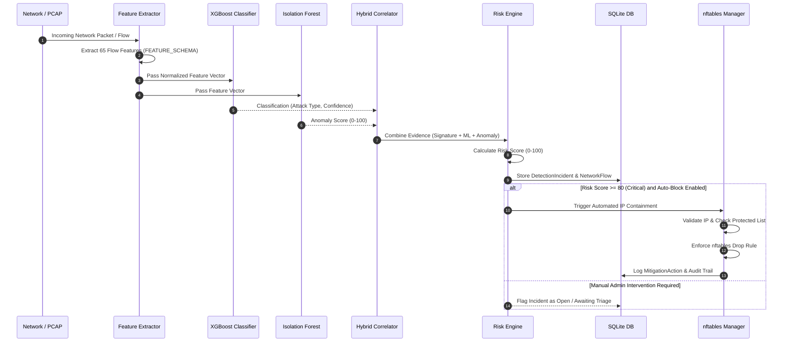

# System Architecture & Technical Specifications

## 1. High-Level Architecture Overview

The Intelligent Hybrid Network Intrusion Detection, Analysis and Automated Prevention System (NIDS/NIPS) is designed around a decoupled, defense-in-depth architecture.

```mermaid
flowchart TD
    subgraph DataSources["Data Sources & Ingestion"]
        PCAP["PCAP / PCAPNG Files"]
        LiveNet["Network Interface (Scapy / tcpdump)"]
        SuricataLogs["Suricata EVE JSON Alerts"]
        ZeekLogs["Zeek Metadata Logs (conn, http, dns)"]
        Datasets["Offline Datasets (CIC-IDS2017, UNSW-NB15)"]
    end

    subgraph FeaturePipeline["Feature Processing Pipeline"]
        FlowExtractor["Flow & Metadata Extractor"]
        Cleaner["Data Cleaner (NaN/Inf Handling)"]
        LeakageGuard["Leakage Guard (Drops IP, Timestamp, FlowID)"]
        Scaler["StandardScaler & Protocol Encoder"]
    end

    subgraph DetectionEngines["Multi-Engine Detection Tier"]
        SignatureEngine["Signature Engine (Suricata Alerts)"]
        SupervisedML["Supervised ML (XGBoost / RF / LightGBM)"]
        AnomalyEngine["Unsupervised Anomaly (Isolation Forest)"]
    end

    subgraph HybridAndExplain["Correlation & Explainability Tier"]
        HybridEngine["Hybrid Detection Aggregator"]
        SHAP["SHAP Feature Attribution (TreeExplainer)"]
        RiskScorer["Threat Severity & Risk Engine (0-100)"]
    end

    subgraph ResponseAndStorage["Mitigation & Persistence Tier"]
        DB[(SQLite Database)]
        AuditLog["Immutable Audit Logger"]
        Nftables["Linux nftables Firewall Manager"]
    end

    subgraph Presentation["User & API Interfaces"]
        API["FastAPI REST Backend (Port 8000)"]
        Dashboard["Streamlit SOC Operations Dashboard (Port 8501)"]
    end

    DataSources --> FeaturePipeline
    FeaturePipeline --> DetectionEngines
    DetectionEngines --> HybridAndExplain
    HybridAndExplain --> ResponseAndStorage
    ResponseAndStorage --> API
    API --> Dashboard
```

---

## 2. Detection Flow & Incident Lifecycle

---

## 3. Core Subsystems

### 3.1 Network Traffic Collection & Processing
- **PCAP Processor**: Parses PCAP/PCAPNG packets into bidirectional flows identified by 5-tuples `(src_ip, dst_ip, src_port, dst_port, protocol)`.
- **Zeek & Suricata Parsers**: Ingests structured JSON (`eve.json`) and tab-separated Zeek logfiles (`conn.log`, `dns.log`, `http.log`).

### 3.2 Feature Engineering Pipeline
- Enforces an internal schema of 65 network flow features (`FEATURE_SCHEMA`).
- Strictly removes non-generalizing identifiers (`src_ip`, `dst_ip`, `timestamp`, `flow_id`) from training and inference feature matrices.
- Saves fitted scalers and encoders using Joblib to guarantee zero training-serving skew.

### 3.3 Multi-Engine Detection Tier
1. **Signature Engine**: Ingests confirmed Suricata signatures (weight = 0.90).
2. **Supervised ML Engine**: Evaluates supervised algorithms (Logistic Regression, Random Forest, LightGBM, and XGBoost as primary candidate) with SMOTE oversampling applied strictly to training folds.
3. **Anomaly Engine**: Isolation Forest trained exclusively on benign traffic baselines, computing normalized outlier scores.

### 3.4 Hybrid Correlation & Threat Scoring
- Implements weighted multi-criteria aggregation rather than naive majority voting.
- Assigns configurable risk scores using the formula:
  $$\text{Risk Score} = 0.40 \cdot C_{\text{ML}} + 0.30 \cdot S_{\text{attack}} + 0.20 \cdot A_{\text{IF}} + 0.10 \cdot F_{\text{freq}}$$
- All components are normalized to a 0–100 scale:
  - **0–29**: Low Severity (Log event)
  - **30–59**: Medium Severity (Alert & monitor frequency)
  - **60–79**: High Severity (Require administrator approval)
  - **80–100**: Critical Severity (Automated blocking eligible under safe conditions)

### 3.5 Automated Mitigation & Containment
- Manages Linux `nftables` chains using strict `subprocess.run(..., shell=False)` argument vectors.
- Implements safety constraints:
  - Never blocks loopback (`127.0.0.1`, `::1`) or configured management IPs.
  - Enforces safe simulation mode by default.
  - Automatically manages block expiry timestamps and rollback commands.
