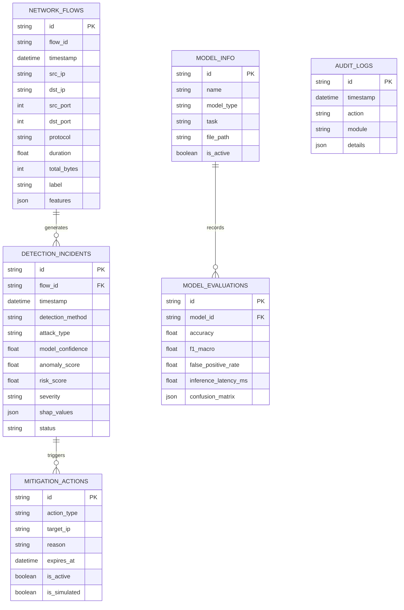

# Database Schema & Entity Documentation

The system utilizes SQLite (compatible with PostgreSQL/MySQL via SQLAlchemy) with tables optimized for time-series flow indexing and incident auditability.

---

## 1. Entity-Relationship Diagram

---

## 2. Table Specifications

### 2.1 `network_flows`
Stores individual network flows extracted from PCAPs, datasets, or live captures.
- **Indexes**: `ix_flow_src_dst` on `(src_ip, dst_ip)`, `ix_flow_label` on `label`.

### 2.2 `detection_incidents`
Stores security events flagged by signature, ML, anomaly, or hybrid engines.
- **Indexes**: `ix_incident_severity`, `ix_incident_status`, `ix_incident_method`.

### 2.3 `model_info` & `model_evaluations`
Maintains model artifact metadata, trained version history, and empirical benchmark evaluation results.

### 2.4 `mitigation_actions`
Maintains the state of all firewall containment actions (active, expired, unblocked) and simulation status.

### 2.5 `audit_logs`
Append-only log recording critical administrative events, model deployments, and firewall changes.
